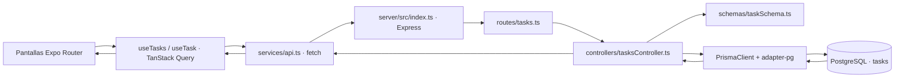

# Guía técnica para agentes de IA — To-Do List móvil

Esta guía permite continuar el proyecto sin reconstruir su contexto desde cero. Describe **el estado que refleja el código actual**, cómo ejecutar y verificar cada parte, qué contratos no deben romperse y dónde hacer cambios. Para instalación detallada y solución de problemas del usuario, consulta también [README.md](README.md); el plan de trabajo registrado está en [`plan movil.md`](plan%20movil.md).

## 1. Cómo orientarse antes de cambiar código

### Fuentes de verdad

Si encuentras contradicciones, sigue este orden:

1. La solicitud más reciente de la usuaria define el alcance de la tarea.
2. El código, las configuraciones y los lockfiles describen lo que existe ahora; no des por hecho que una casilla antigua del plan sigue pendiente.
3. `README.md` es la guía de instalación y uso para una persona que clona el proyecto.
4. [`plan movil.md`](plan%20movil.md) conserva las decisiones, fases y notas históricas del desarrollo.

**Nombre real del plan:** el archivo presente en el repositorio es `plan movil.md`, aunque su encabezado y una referencia del README lo llamen `plan.md`. No existe un archivo raíz `plan.md` en la estructura actual. Usa el nombre real al abrir o enlazar el plan.

### Convenciones del proyecto

- Conversación y textos visibles de la app en español; identificadores de código en inglés; comentarios breves en español.
- Mantener Expo + React Native + TypeScript, Expo Router, React Native Paper, React Hook Form, Zod, TanStack Query, Express, Prisma y PostgreSQL. No cambiar el stack ni añadir dependencias sin autorización de la usuaria.
- El alcance original es el CRUD de tareas. Autenticación, almacenamiento local/offline y consumo de APIs externas son extensiones futuras, no requisitos actuales.
- Reutilizar la estructura y los patrones existentes. La app y la API son paquetes separados; no hay `package.json` en la raíz ni workspace configurado.
- Leer los archivos afectados antes de editar. Si cambia un contrato de datos, seguir el flujo completo móvil → API → base de datos y actualizar todas las capas necesarias.
- No leer, copiar ni divulgar valores de `mobile/.env.local` o `server/.env`; usar solo los `.env.example` como plantilla. Nunca incluir secretos en código, documentación o Git.
- No ejecutar operaciones destructivas sin autorización explícita: por ejemplo `docker compose down -v`, borrar volúmenes o migraciones, `git reset --hard` o hacer force-push. El volumen `pgdata` conserva datos.
- El plan original pide trabajar en pasos pequeños, explicar brevemente cambios importantes y usar checkpoints para trabajo organizado en varias fases. Aplica ese estilo sin convertir una tarea pequeña en fases artificiales; la solicitud actual de la usuaria siempre prevalece.

## 2. Estado y propósito

Aplicación móvil/web sencilla para crear, consultar, editar y eliminar tareas. La app consume una API REST; la API persiste las tareas en PostgreSQL.

| Área | Estado actual |
|---|---|
| App | Expo SDK 57, React Native 0.86.3, React 19 y TypeScript estricto. Rutas con Expo Router. |
| Interfaz | React Native Paper, tema propio, formulario validado con React Hook Form y Zod. Hay ajustes de entrada distintos para móvil y web. |
| Datos cliente | TanStack Query 5; `useTasks` consulta la lista y ejecuta las mutaciones. |
| API | Express 5 + TypeScript; rutas `/health` y CRUD `/tasks`. |
| Persistencia | PostgreSQL 16 en Docker Compose; Prisma 7 con `@prisma/adapter-pg`. |
| Funcionalidad | CRUD conectado y persistente; la lista se actualiza al completar mutaciones. |
| Pruebas | El plan registra verificación manual. No hay scripts de test configurados; Jest, React Native Testing Library y Supertest no están instalados como suite del proyecto. |
| Progreso | El registro de `plan movil.md` marca las fases 0–8 completadas. Las pruebas automatizadas opcionales quedaron sin implementar. |

Las versiones completas y exactas resueltas están en `mobile/package-lock.json` y `server/package-lock.json`. El README registra Node 24.20.0, npm 11.19.0, Git 2.53.0 y Docker Engine/Compose 29.7.2/5.5.1 como versiones usadas durante el desarrollo; son referencia histórica, no mínimos declarados por `package.json`.

## 3. Estructura del repositorio

```text
.
├── .gitignore                         # Exclusiones comunes: dependencias, builds y entornos
├── README.md                           # Instalación, uso, API y problemas comunes
├── documentacion.md                    # Esta guía para agentes
├── plan movil.md                       # Fases, decisiones y registro de progreso
├── docker-compose.yml                  # Solo PostgreSQL; no contenedorizan app ni API
├── docs/
│   └── images/                         # Capturas enlazadas desde README
├── mobile/                             # Expo + React Native
│   ├── .env.example                    # EXPO_PUBLIC_API_URL de ejemplo
│   ├── .gitignore                      # Archivos locales de Expo y entorno
│   ├── app/
│   │   ├── _layout.tsx                 # Providers globales y Stack
│   │   ├── index.tsx                   # Lista, estados, navegación y confirmación de borrado
│   │   └── task/
│   │       ├── new.tsx                 # Alta
│   │       └── view/[id].tsx           # Detalle y edición en línea
│   ├── assets/                         # Iconos y favicon
│   ├── src/
│   │   ├── components/
│   │   │   ├── ScreenHeader.tsx        # Encabezado y navegación de vuelta
│   │   │   ├── TaskForm.tsx            # Formulario compartido alta/edición
│   │   │   └── TaskItem.tsx            # Fila con acciones accesibles
│   │   ├── hooks/useTasks.tsx          # Query y mutaciones de tareas
│   │   ├── schemas/taskSchema.ts       # Validación del formulario móvil
│   │   ├── services/api.ts             # Cliente HTTP y adaptación del ID
│   │   ├── theme.ts                    # Colores y tema de Paper
│   │   └── types/Task.ts               # Modelo que usa la app
│   ├── app.json                        # Configuración Expo y rutas tipadas
│   ├── package.json                    # Scripts y dependencias móviles
│   └── tsconfig.json                   # TypeScript estricto
└── server/                             # API Express + Prisma
    ├── .env.example                    # DATABASE_URL de ejemplo
    ├── package.json                    # Scripts de desarrollo y typecheck
    ├── prisma.config.ts                # URL y configuración de Prisma 7
    ├── prisma/
    │   ├── schema.prisma               # Modelo de datos
    │   └── migrations/                 # SQL versionado; no borrar migraciones aplicadas
    ├── src/
    │   ├── index.ts                    # Express, CORS, JSON, health y errores
    │   ├── routes/tasks.ts             # Enrutamiento del CRUD
    │   ├── controllers/tasksController.ts # Validación, Prisma y respuestas HTTP
    │   ├── schemas/taskSchema.ts       # Validación del body de API
    │   ├── db/prisma.ts                # Cliente Prisma con adapter PostgreSQL
    │   └── generated/prisma/           # Cliente generado; no editar a mano
    └── tsconfig.json                   # TypeScript estricto
```

Las capturas `inicio_sin_to_do.jpg`, `ver_to_do.jpg`, `nueva_to_do.jpg` y `eliminar_to_do.jpg` muestran pantallas vigentes. `editar_to_do.jpg` es histórica: la pantalla de edición separada ya no existe.

## 4. Arquitectura y recorrido de una petición



### App móvil

- `mobile/app/_layout.tsx` crea un único `QueryClient` (las queries no reintentan automáticamente), carga la fuente Lora y monta `QueryClientProvider`, `SafeAreaProvider`, `PaperProvider` y el `Stack` de Expo Router. La pantalla raíz queda en blanco hasta que carga la fuente.
- `mobile/app/index.tsx` obtiene la lista mediante `useTasks`; representa carga, error con acción **Reintentar**, lista vacía y cantidad de pendientes. **Nueva tarea** abre `/task/new`; pulsar el contenido de una fila abre su detalle. El borrado de la fila pide confirmación.
- `mobile/app/task/new.tsx` entrega `addTask` a `TaskForm`. El título es obligatorio y la descripción opcional; tras una creación exitosa el formulario se restablece y vuelve a la lista.
- `mobile/app/task/view/[id].tsx` consulta la tarea por ID y presenta la tarjeta. Tocar el título o la descripción abre ese campo para sobrescribirlo; **Guardar** aplica el cambio y **Cancelar** lo descarta. No hay ruta ni botón separado de edición.
- `TaskForm` se usa solo para crear tareas. El formulario de alta limpia sus valores y vuelve a la lista al guardar correctamente.
- `TaskItem` abre el detalle al pulsar el título/descripción, muestra “Sin descripción” si no hay texto y mantiene el control **Eliminar** de la lista.
- En plataformas nativas el formulario de alta usa `TextInput` de Paper. En web usa `TextInput` de React Native con estilos propios; mantener esta bifurcación si se modifica esa pantalla.
- `theme.ts` centraliza colores y tipografía. El título de pantalla usa Lora; el cuerpo usa la fuente sans del sistema.

### Estado remoto y cliente HTTP

- La clave de lista es `['tasks']`; los detalles usan `['tasks', id]`. `useTasks` expone listado y mutaciones; `useTask` carga una tarea y ofrece sus mutaciones de edición y borrado.
- Las mutaciones invalidan el prefijo `['tasks']` al tener éxito, refrescando lista y detalles activos. No hay actualización optimista; el `QueryClient` global desactiva reintentos de query.
- `services/api.ts` consulta `/tasks` y `/tasks/:id`, elimina barras finales de `EXPO_PUBLIC_API_URL` y convierte el ID numérico a `string`. Los `404` se identifican como “Tarea no encontrada”; los demás errores HTTP usan el mensaje genérico.
- `Task` móvil permite `description: string | null`; Prisma también devuelve `null` cuando no se proporcionó descripción.

### API y acceso a datos

- `server/src/index.ts` carga dotenv, crea Express, habilita JSON y CORS, registra `/health`, monta `tasksRouter` en `/tasks` y termina con un middleware de error que responde `500` genérico.
- `routes/tasks.ts` mantiene las rutas finas y delega en el controlador.
- `tasksController.ts` valida altas/ediciones, obtiene una tarea con `findUnique` y ejecuta las operaciones Prisma. `GET /tasks` ordena por `createdAt` descendente; `GET /tasks/:id` valida el ID y responde `404` si no la encuentra.
- `db/prisma.ts` crea una instancia Prisma compartida y la conecta mediante `PrismaPg` usando `DATABASE_URL`.
- `prisma.config.ts` carga dotenv y entrega `DATABASE_URL` a Prisma 7. El cliente generado en `src/generated/prisma` se recrea con `prisma generate`; no corregir manualmente sus archivos.

## 5. Contratos de dominio y API

### Modelo de tarea

| Campo | Tipo en API/DB | Regla actual |
|---|---|---|
| `id` | `number` en API y `SERIAL`/`Int` en PostgreSQL; `string` en la app | Autoincremental. El cliente móvil convierte la respuesta a string. |
| `title` | `string`, `VARCHAR(100)` | Obligatorio, mínimo 1 y máximo 100 caracteres según Zod. |
| `description` | `string | null`, `TEXT NULL` | Opcional; la API convierte texto vacío, `null` o ausente en `null`. Sin máximo configurado. |
| `createdAt` | `DateTime` | `now()`; se guarda como `created_at`. |
| `updatedAt` | `DateTime` | Se actualiza con `@updatedAt`; se guarda como `updated_at`. |

El esquema Prisma y la migración inicial están en `server/prisma/schema.prisma` y `server/prisma/migrations/20261031025701_init/migration.sql`.

### Esquema Prisma actual

```prisma
generator client {
  provider = "prisma-client"
  output   = "../src/generated/prisma"
}

datasource db {
  provider = "postgresql"
}

model Task {
  id          Int      @id @default(autoincrement())
  title       String   @db.VarChar(100)
  description String?  @db.Text
  createdAt   DateTime @default(now()) @map("created_at")
  updatedAt   DateTime @updatedAt @map("updated_at")

  @@map("tasks")
}
```

### Endpoints implementados

Base local predeterminada: `http://localhost:3000`.

| Método | Ruta | Body | Resultado normal | Errores previstos |
|---|---|---|---|---|
| `GET` | `/health` | — | `200`, `{"status":"ok"}` | — |
| `GET` | `/tasks` | — | `200`, arreglo ordenado por creación descendente; puede ser `[]` | Error interno `500` |
| `GET` | `/tasks/:id` | — | `200`, tarea individual | `400` si el ID no es válido; `404` con `{"error":"Tarea no encontrada"}` |
| `POST` | `/tasks` | `{"title":"...","description":"..."}` (`description` opcional) | `201`, tarea creada | `400` con `{ "errors": { ... } }` si no valida; error interno `500` |
| `PUT` | `/tasks/:id` | Título obligatorio; descripción opcional | `200`, tarea actualizada | `400` si no valida; `404` si no existe |
| `DELETE` | `/tasks/:id` | — | `204`, sin body | `404` con `{"error":"Tarea no encontrada"}` para errores atrapados por el controlador |

Ejemplo de tarea serializada por Express (la fecha real depende del servidor):

```json
{
  "id": 1,
  "title": "Preparar evaluación",
  "description": "Revisar los requisitos del proyecto",
  "createdAt": "2026-11-01T12:00:00.000Z",
  "updatedAt": "2026-11-01T12:00:00.000Z"
}
```
Si no se proporciona descripción, la respuesta incluye `"description": null`.

### Validación y diferencias importantes

Los esquemas de móvil y servidor están duplicados; no comparten un paquete:

- `mobile/src/schemas/taskSchema.ts` recorta título y descripción; exige título no vacío y lo limita a 100. La descripción admite vacío o ausencia; el formulario la envía como string vacío.
- `server/src/schemas/taskSchema.ts` convierte descripción ausente, `null` o vacía (tras recortar espacios) en `null`. El título tiene mínimo 1 y máximo 100, pero no se recorta en el servidor, así que una petición directa con título formado solo por espacios puede pasar.
- La base acepta `description NULL`; la migración `20261121000000_optional_description` elimina `NOT NULL` sin modificar registros existentes. No hay máximo de descripción.
- `PUT` requiere título; descripción ausente, `null` o en blanco se guarda como `null`.

Los errores de validación responden con `400` y un objeto `errors`. `GET /tasks/:id` responde `400` para un ID inválido y `404` si no encuentra la tarea; `PUT`/`DELETE` usan `404` para errores atrapados por sus controladores; el middleware final responde `500` a errores no capturados.

## 6. Entorno, instalación y ejecución

No hay instalación centralizada: ejecuta `npm ci` por separado dentro de `server/` y `mobile/`. La guía completa y los pasos de red están en `README.md`.

### Variables de entorno

1. Copia las plantillas desde la raíz:

```powershell
Copy-Item server/.env.example server/.env
Copy-Item mobile/.env.example mobile/.env.local
```

En macOS/Linux/Git Bash usa `cp` en lugar de `Copy-Item`.

2. Ajusta `mobile/.env.local` según el destino:

| Dónde corre la app | `EXPO_PUBLIC_API_URL` |
|---|---|
| Teléfono físico con Expo Go | `http://<IPv4-del-computador>:3000` |
| Emulador Android | `http://10.0.2.2:3000` |
| Web en el mismo computador | `http://localhost:3000` |

`localhost` en el teléfono refiere al teléfono, no al computador. Para teléfono físico, ambos deben estar en la misma Wi‑Fi y el firewall debe permitir la API. `EXPO_PUBLIC_API_URL` se incluye en el bundle público: nunca poner credenciales allí. Reinicia Metro después de cambiarla.

3. `server/.env` usa `DATABASE_URL` para conectar desde el servidor al PostgreSQL del host. El ejemplo corresponde a Compose en `localhost:5433`; si se cambian puerto, base, usuario o contraseña, alinea `DATABASE_URL` con Compose.

El `docker-compose.yml` admite un `.env` opcional en la raíz para `POSTGRES_USER`, `POSTGRES_PASSWORD`, `POSTGRES_DB` y `POSTGRES_PORT`. El puerto publicado predeterminado es `127.0.0.1:5433`; el contenedor escucha en `5432`. Los valores predeterminados del README son únicamente de desarrollo local.

El `.gitignore` raíz excluye `.env` y `.env.*`, salvo `.env.example`; `mobile/.gitignore` excluye también `.env*.local`. Mantén las plantillas, no los archivos locales.

### Arranque desde cero

Desde la raíz, inicia la base:

```bash
docker compose up -d
docker compose ps
```

Espera a que el servicio `db` esté `healthy`. El volumen `pgdata` conserva la información al detener el contenedor.

En una terminal dentro de `server/`:

```bash
npm ci
npx prisma generate
npx prisma migrate deploy
npm run dev
```

La API escucha por defecto en el puerto `3000`. Comprueba `http://localhost:3000/health`; en PowerShell también sirve `Invoke-RestMethod http://localhost:3000/health`.

En otra terminal dentro de `mobile/`:

```bash
npm ci
npx expo start
```

Escanea el QR desde Expo Go compatible con SDK 57, o usa `npm run web` para el navegador. `npm run android` y `npm run ios` también están declarados como scripts de Expo; la documentación de usuario se centra en teléfono, Android y web.

Para parar, detén Metro y API con `Ctrl+C`; usa `docker compose stop` para parar la base sin borrar `pgdata`. **No uses `docker compose down -v`** si se deben conservar tareas.

## 7. Comandos de desarrollo y verificación

### Scripts declarados

| Paquete | Comando | Propósito |
|---|---|---|
| `mobile/` | `npm run start` | `expo start` |
| `mobile/` | `npm run web` | `expo start --web` |
| `mobile/` | `npm run android` / `npm run ios` | Abrir el destino indicado con Expo |
| `mobile/` | `npm run lint` | `expo lint` |
| `mobile/` | `npm run format` | `prettier --write .`; modifica archivos, úsalo solo cuando se busca formatear todo el paquete |
| `server/` | `npm run dev` | `tsx watch src/index.ts` |
| `server/` | `npm run typecheck` | `tsc --noEmit` |

No hay script `test`, `build` ni `lint` declarado en `server/`. Para móvil, el typecheck disponible se ejecuta directamente:

```bash
# Desde mobile/
npx tsc --noEmit
npm run lint

# Desde server/
npm run typecheck
```

`npx prisma generate` genera el cliente a partir del esquema. `npx prisma migrate deploy` aplica migraciones existentes en una BD. Al desarrollar un cambio de esquema, crea una migración versionada en vez de editar la tabla manualmente; la migración inicial y los lockfiles son parte del historial del proyecto. No edites ni elimines migraciones que ya se hayan aplicado.

### Lista de aceptación manual

- Abrir lista vacía y comprobar el estado vacío.
- Crear una tarea válida; verificar que aparece y que el formulario se limpia al guardar.
- Intentar guardar un título vacío o de más de 100 caracteres; comprobar los mensajes. Dejar la descripción vacía sí debe permitir guardar.
- Abrir una tarea desde la lista; tocar el título y la descripción para sobrescribirlos; verificar **Guardar**, **Cancelar** y la actualización de la tarjeta.
- Cancelar un borrado y luego confirmar otro; comprobar el estado al borrar la última tarea.
- Apagar la API temporalmente: la app debe mostrar el error y permitir reintentar sin cerrarse.
- Comprobar persistencia al detener/reiniciar la app/API, manteniendo `pgdata`.
- Para comprobar la API: probar `/health`, `GET /tasks`, `GET /tasks/:id` válido/inválido/inexistente, `POST` con y sin descripción, `PUT` con descripción vacía, y `DELETE` exitoso e inexistente.

El registro del README/plan es histórico. Al afirmar que un cambio nuevo funciona, ejecuta la verificación más acotada que cubra esa modificación; no presentes como ejecutadas las pruebas automatizadas que no existen.

## 8. Guía para ampliar el proyecto

### Si cambia el modelo o formulario de tareas

Trazar el dato por todas las capas afectadas, en lugar de modificar solo la pantalla:

1. Actualizar la validación de `mobile/src/schemas/taskSchema.ts`; `TaskFormValues` se infiere de ese schema.
2. Actualizar `server/src/schemas/taskSchema.ts` para que la API aplique reglas compatibles.
3. Si el dato persiste, actualizar `server/prisma/schema.prisma`, crear la migración SQL correspondiente y regenerar Prisma con `npx prisma generate`.
4. Actualizar `mobile/src/types/Task.ts` si cambia el recurso retornado; revisar la adaptación en `mobile/src/services/api.ts`.
5. Actualizar `tasksController.ts` si la entrada/salida o las consultas cambian.
6. Ajustar `TaskForm`, `TaskItem` y las pantallas que presentan o editan el campo.
7. Revisar los ejemplos de API en `README.md` y esta guía.

No copies una regla solo al frontend: la API es una frontera independiente y debe validar su propio input.

### Si se agrega una operación o pantalla

- API: ruta en `server/src/routes/tasks.ts` → handler en `controllers/tasksController.ts` → validación Zod y consulta Prisma. Mantener respuestas y códigos HTTP explícitos.
- Cliente: función de red en `mobile/src/services/api.ts` → query/mutation y clave/invalidation en `mobile/src/hooks/useTasks.tsx` → pantalla Expo Router que la consume.
- Pantallas: crear/modificar archivos bajo `mobile/app/`; Expo Router deriva las rutas de esos archivos. `typedRoutes` está habilitado en `mobile/app.json`.
- Si una mutación afecta la lista, invalidar `['tasks']` al completarse con éxito, siguiendo el patrón actual.
- Mantener los estados de carga, error, vacío y reintento cuando corresponda; mantener etiquetas y roles de accesibilidad.

### Si cambia la base de datos

- Mantener `schema.prisma` y migraciones SQL sincronizados.
- Crear migración versionada para cambios de estructura y regenerar `src/generated/prisma` con Prisma; el directorio generado no es el lugar para implementar lógica.
- Asegurar que `DATABASE_URL` apunte a la misma base/puerto que Compose.
- No borrar el volumen o historial de migraciones para resolver una inconsistencia sin permiso explícito.

## 9. Límites y riesgos conocidos del estado actual

Estos puntos describen el comportamiento presente; no son autorización para ampliar alcance automáticamente.

- La app no implementa autenticación, usuarios, permisos, persistencia offline, sincronización ni APIs externas. Todas las tareas pertenecen al único conjunto de datos de la base.
- No hay paginación. `GET /tasks/:id` carga el detalle individual; título y descripción se editan en línea, sin una ruta separada.
- CORS está habilitado con la configuración predeterminada de `cors`; no hay lista de orígenes ni autenticación. Está pensado para desarrollo/uso local, no constituye una configuración de producción.
- `GET /tasks/:id` valida un entero positivo dentro del rango de `Int`. Los controladores heredados de `PUT`/`DELETE` siguen convirtiendo `req.params.id` con `Number()` sin validación explícita y capturan cualquier error de Prisma como `404`.
- El cliente móvil muestra el error genérico ante fallos de red/HTTP; los `404` del endpoint individual se muestran como “Tarea no encontrada”. No hay timeout ni presentación de errores detallados de Zod.
- La descripción se normaliza a `null` cuando falta o queda vacía. La app recorta el título, pero la validación del servidor no; una petición directa con título de espacios puede pasar.
- No hay suite automatizada de pruebas configurada ni script de lint para el servidor. Las pruebas opcionales que menciona el plan no forman parte de las dependencias actuales.
- Credenciales y puertos de Compose son valores de desarrollo. Antes de una publicación real se requerirían decisiones explícitas de autenticación, CORS, secretos, despliegue, límites de entrada y manejo de errores; no asumirlas para una tarea del CRUD.

## 10. Estado del plan y documentación relacionada

El registro de [`plan movil.md`](plan%20movil.md) marca las fases 0–8 —entorno, app, UI, CRUD local, PostgreSQL, API, integración, pulido y README— como completadas. La fase 7 menciona React Native Testing Library como opcional y no ejecutada; la fase 5 deja Jest/Supertest como opcional. El estado real se debe confirmar en el código y scripts, no solo en esas casillas.

Referencias útiles:

- [`README.md`](README.md): preparación, ejecución, endpoint, capturas y solución de problemas para usuarios.
- [`plan movil.md`](plan%20movil.md): decisiones iniciales, alcance académico y bitácora histórica.
- `docker-compose.yml`: configuración local de PostgreSQL.
- `mobile/package.json` y `server/package.json`: dependencias y comandos realmente disponibles.
- `mobile/.env.example` y `server/.env.example`: plantillas seguras de configuración.
